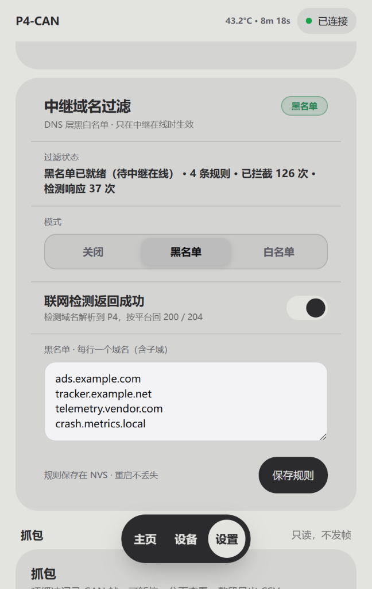
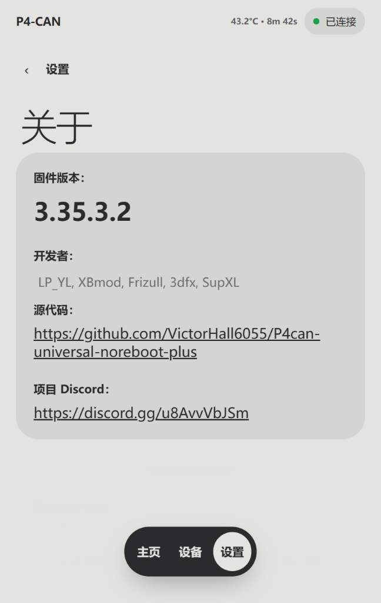
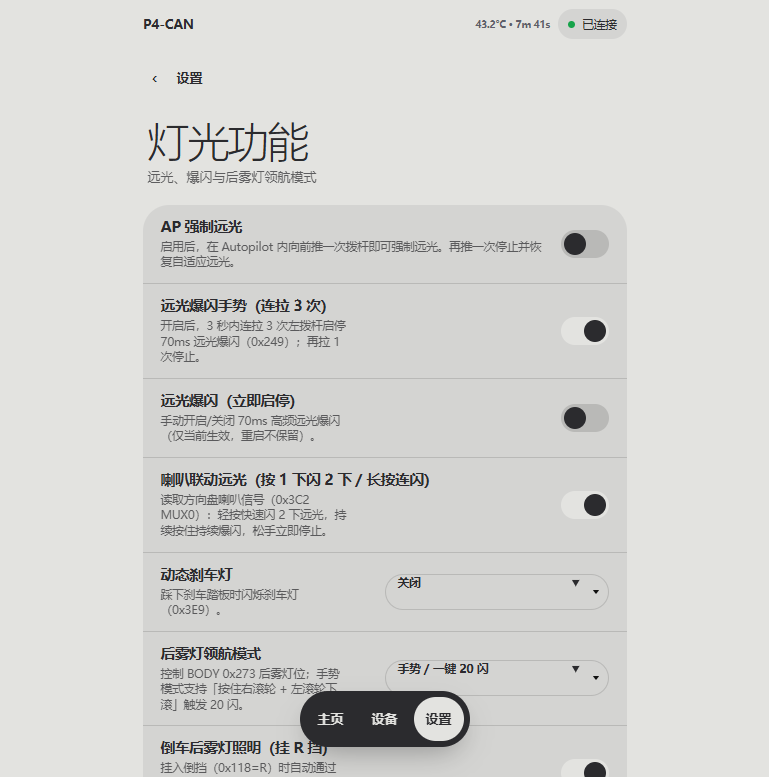
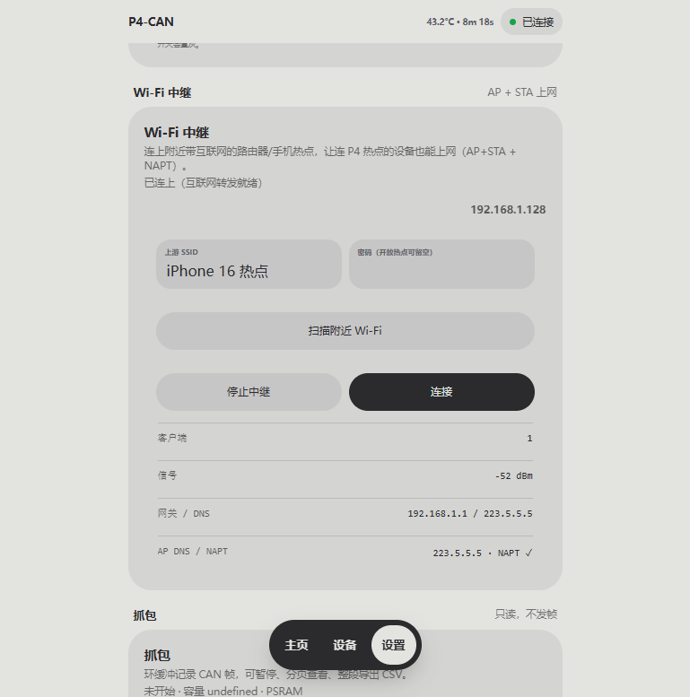
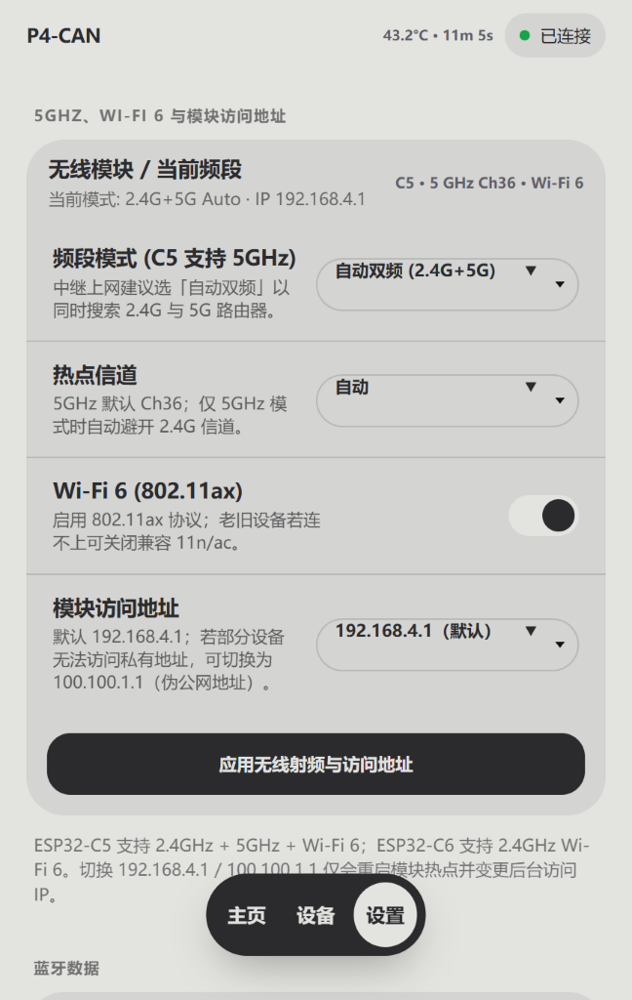
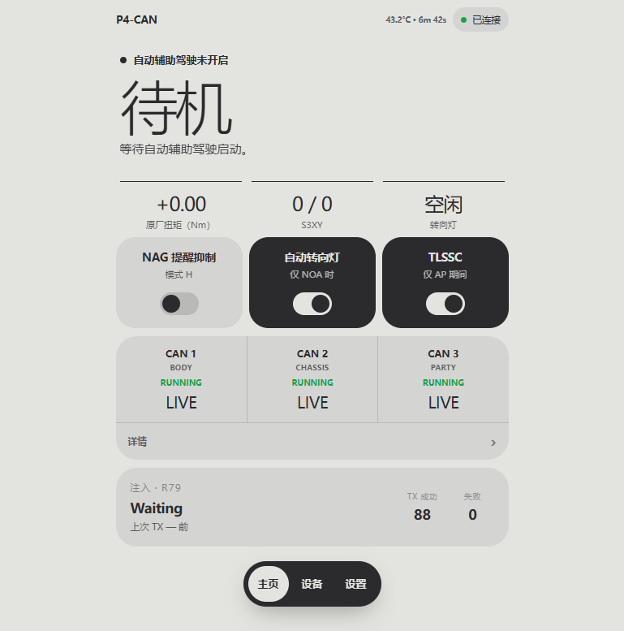
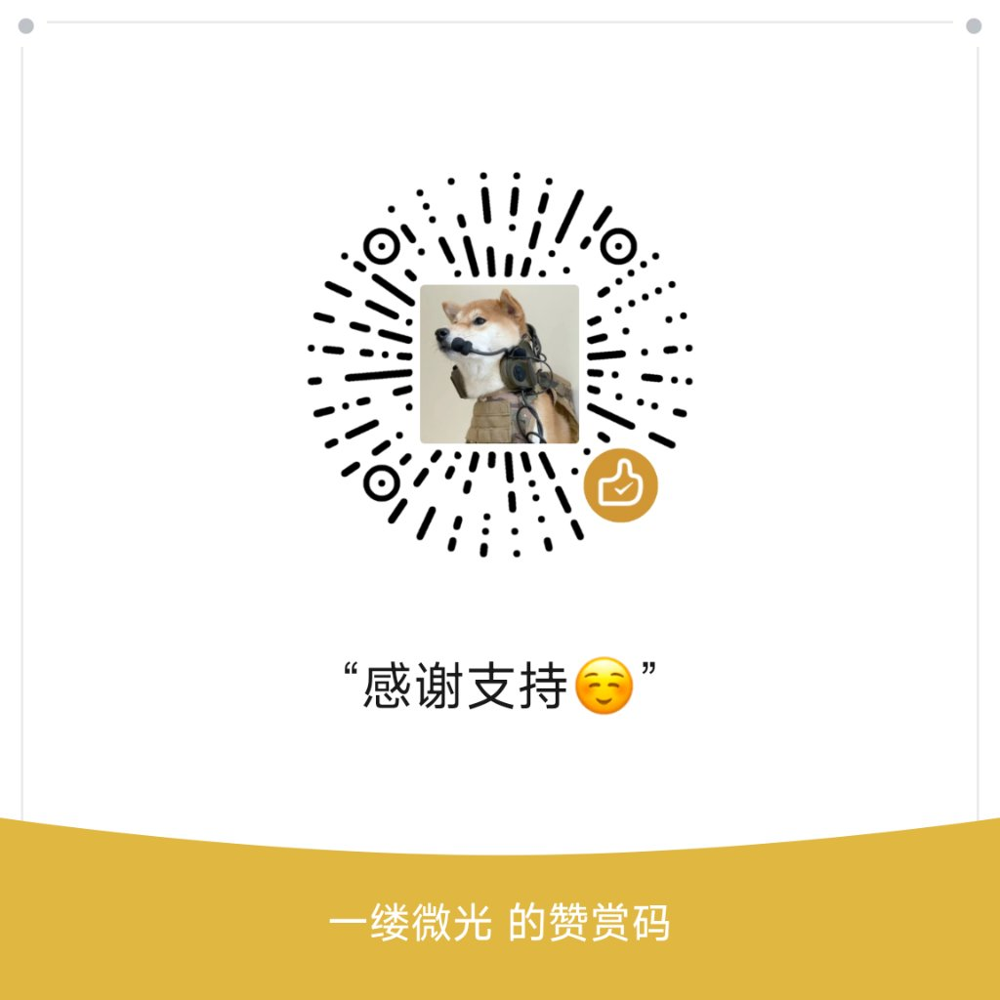

# P4can-universal-noreboot-plus (`3.35.3.2`)

> **Language / 语言**: **English** | **[简体中文说明 (README.zh-CN.md)](README.zh-CN.md)**

An enhanced ESP32-P4 Tesla CAN gateway firmware built upon **[CARyanChan/P4can-universal-noreboot](https://github.com/CARyanChan/P4can-universal-noreboot)** (`v3.35.3-norestart2`) and integrated with verified lighting & pilot interactions inspired by **[i520e3e4/p4can-unlock-more](https://github.com/i520e3e4/p4can-unlock-more)**.

While adding new lighting, networking, and diagnostic capabilities, **TLSSC Anti-Reboot (`0x331` via `tlssc_norestart.h`) strictly retains the highest TX and task priority** on CAN-B (`P4_TLSSC_NR_PRIORITY_YIELD`). Both **ESP32-P4 + ESP32-C5** (5 GHz Dual-Band & Wi-Fi 6) and **ESP32-P4 + ESP32-C6** (2.4 GHz Wi-Fi 6) boards are supported with 32 MB flash builds.

> **v3.35.3.2 Updates**:
> - Fixed **2021 Model 3 Rear Fog (`0x273` / `0x3E3`)** compatibility (wider BODY cadence tolerance, `0x3E3` 2-bit status decoding, `40ms` refresh, non-blocking fallback).
> - Fixed **AP Forced High Beam** dropping after a few seconds (cross-core signed timestamp check, push-echo race fix, cooldown re-arm).
> - Added **Repeater DNS Domain Filter** (Blacklist / Whitelist persisted in NVS) with **200 / 204 Connectivity Probe Spoofing**.
> - Added **Dashboard Access IP Option** (`192.168.4.1` default vs `100.100.1.1` pseudo-public IP) and updated project URL to `https://github.com/VictorHall6055/P4can-universal-noreboot-plus`.

<p align="center">
  
  
</p>

---

## Key New Highlights

### 1. Horn-to-High-Beam Flash & Extended Lighting (`lighting/`)
Reads the physical steering-wheel horn switch directly on the BODY CAN bus (`0x3C2` MUX0 bit 2, `VCLEFT_hornSwitchPressed`) so Walk-Away Lock or Sentry Mode horn chirps do **not** trigger accidental flashes:
- **Tap Horn**: Triggers **2 quick high-beam flashes** (70 ms half-period).
- **Hold Horn**: Continuously strobes high beam until released, then issues an automatic release frame (with a 600 ms stale-input safety timeout).
- **Stalk & Non-Stalk Support**: Uses `0x249` on stalk vehicles (`TURN_SIGNAL_STALK`) and safely falls back to `0x3E9` on stalkless vehicles, yielding immediately whenever `0x331` Anti-Reboot is active.
- **Full Lighting Suite**: Also includes **AP Forced High Beam**, **3x-Pull High-Beam Strobe Gesture**, **Immediate High-Beam Strobe**, **Dynamic Brake Light (Off / Light / Hard)**, **Rear Fog Pilot Mode** (`0x273` 20x Burst / 1 Hz Pulse / Steady), and **Reverse Gear Rear Fog Assist** (`0x118` Gear R → `0x273`).

> Note: Unverified or BLE-only items (such as cabin ambient lighting or BLE seat/HVAC controls without verified CAN bus frames) are intentionally **not** fabricated on CAN to protect vehicle bus stability.

<p align="center">
  
</p>

### 2. Wi-Fi Repeater Mode with Fixed DNS & NAPT (`p4_uplink.h`, `p4_network.h`)
Turn your P4-CAN module into an internet-sharing **AP + STA NAPT repeater** so phones or laptops connected to the `P4-CAN` Wi-Fi AP can access the internet through a nearby 2.4 GHz / 5 GHz router or phone hotspot:
- Fixed ESP-IDF / Arduino DHCPS DNS forwarding by setting `ESP_NETIF_DNS_MAIN/BACKUP` via `esp_netif_set_dns_info()` and properly passing `dhcps_offer_t` (`OFFER_DNS`) to `esp_netif_dhcps_option()` (instead of raw IPv4 bytes), plus initial AP DNS (`223.5.5.5`) configured at AP boot.
- Enforces `WiFi.STA.setDefault()` + `WiFi.AP.enableNAPT(true)` when the uplink joins, and flags `subnet-conflict` cleanly if the upstream hotspot uses `192.168.4.0/24` (same subnet as P4's default AP `192.168.4.1`).
- Displays real-time **AP DNS / NAPT** readiness (`223.5.5.5 · NAPT ✓`), RSSI, gateway/DNS, and station count in the dashboard.

<p align="center">
  
</p>

### 3. ESP32-P4 + ESP32-C5 Wi-Fi Fix, Dual-Band Wi-Fi 6 (`802.11ax`) & Access Address (`192.168.4.1` / `100.100.1.1`)
- **ESP-Hosted C5 Compatibility Fix (`tools/patch_c5_hosted.py`)**: Patches `libespressif__esp_hosted.a(transport_drv.c.obj)` (`process_priv_communication`) so ESP32-P4 recognizes the ESP32-C5 slave chip ID (`23` / `esp32c5`) instead of rejecting it as C6-only (`13`), resolving the "C5 board boots with no Wi-Fi" issue.
- **Dual-Band & Wi-Fi 6 UI Controls (`#panelWireless`)**: On C5 hardware (`P4CAN_HOSTED_C5`), exposes **Band Mode** (`2.4G+5G Auto` / `5G Only` / `2.4G Only`), **AP Channel** (`Auto`, 2.4 GHz Ch 1–11, 5 GHz Ch 36–165), and **Wi-Fi 6 (`802.11ax`)** toggle persisted in NVS (with a toggleable compatibility fallback to 11n/ac for older client devices). Automatically hides 5 GHz controls on C6 hardware.
- **Selectable Dashboard Access IP**: Choose between **`192.168.4.1`** (default) and **`100.100.1.1`** (pseudo-public IP) persisted in NVS, enabling access on devices/clients that restrict `192.168.x.x` private subnets.

<p align="center">
  
</p>

### 4. Top-Right MCU Temp / Uptime & Dynamic C5/C6 CAN GPIO Editor
- **Live MCU Temp & Uptime (`#topSysMeta`)**: Samples ESP32-P4's internal thermal sensor (`temperatureRead()`, cached every 2 s) and streams `chipTempC` + `uptimeS` across snapshot endpoints to the global top-right status header.
- **Editable CAN GPIO Mapping for Both C5 & C6**: Fixed `canGpioResponse` validation mismatch when C5 firmware allows `GPIO 6`, and added a **Custom CAN Wiring? Edit CAN GPIO** button directly on the first-boot Vehicle Setup screen so boards with non-default transceiver pinouts can be reconfigured before selecting a vehicle profile.

<p align="center">
  
</p>

---

## Core Inherited Features
- **TLSSC Anti-Reboot (`0x331`)**: Single-shot NVS frame caching, 60 s / 10 Hz / 600-frame replay window on power-up, bus recovery, and >15 s head-unit silence (`wakeRearms`), yielding immediately once vehicle `0x331` resumes.
- **Auto Blinker / NAG Suppression (Mode H & TSL9)**, **R79 Summon Timing Fix**, **SmartShift (Beta)**, **Battery Preheating (Beta)**, **Continuous AP**, **Service Mode**, **FSD Visualisation**, **S3XY BLE Button Integration**, and **PSRAM Packet Capture** (CSV export).

---

## Building & Flashing Firmware

> ⚠️ **32 MB ESP32-P4 REV3.X boards ONLY** (`app5M_fat24M_32MB`). Do **not** flash onto 16 MB boards, and do **not** mix up **C5** and **C6** builds (wrong companion firmware causes missing Wi-Fi).

### Build Targets (`Compile-P4-C5-C6.ps1`)
Requires **Arduino CLI** + **esp32 Arduino core `3.3.12`** (3.3.13 renamed TWAI HAL symbols and will not compile) + Python 3:

```powershell
cd P4can-universal-noreboot
powershell -NoProfile -ExecutionPolicy Bypass -File .\Compile-P4-C5-C6.ps1
```

Outputs to `Final-Build/`:
| Variant | Companion Radio | Language | OTA Update (`.bin`) | Full Flash Merged (`.merged.bin`) |
| --- | --- | --- | --- | --- |
| C5 中文版 | ESP32-C5 (5 GHz + Wi-Fi 6) | 简体中文 | `P4can-universal-noreboot.C5.zh-CN.OTA.REV3.X.bin` | `P4can-universal-noreboot.C5.zh-CN.FULLFLASH.REV3.X.merged.bin` |
| C5 English | ESP32-C5 (5 GHz + Wi-Fi 6) | English | `P4can-universal-noreboot.C5.en.OTA.REV3.X.bin` | `P4can-universal-noreboot.C5.en.FULLFLASH.REV3.X.merged.bin` |
| C6 中文版 | ESP32-C6 (2.4 GHz Wi-Fi 6) | 简体中文 | `P4can-universal-noreboot.C6.zh-CN.OTA.REV3.X.bin` | `P4can-universal-noreboot.C6.zh-CN.FULLFLASH.REV3.X.merged.bin` |
| C6 English | ESP32-C6 (2.4 GHz Wi-Fi 6) | English | `P4can-universal-noreboot.C6.en.OTA.REV3.X.bin` | `P4can-universal-noreboot.C6.en.FULLFLASH.REV3.X.merged.bin` |

Check [Final-Build/manifest.json](Final-Build/manifest.json) and GitHub **Releases** for prebuilt binaries and SHA-256 checksums.

---

## Acknowledgements / 致谢

Heartfelt thanks to the authors and contributors of the two source projects that made this build possible, as well as the original upstream authors:
- **[CARyanChan/P4can-universal-noreboot](https://github.com/CARyanChan/P4can-universal-noreboot)** — Core Anti-Reboot (`0x331`), clean modular UI, Wi-Fi Uplink & PSRAM Capture architecture, and stability baseline.
- **[i520e3e4/p4can-unlock-more](https://github.com/i520e3e4/p4can-unlock-more)** — Feature inspiration and CAN/TSL research for Horn-to-High-Beam linkage, Strobe, and Rear Fog Pilot interactions.
- Upstream lineage: **[06066060606060/P4can-universal-unlock](https://github.com/06066060606060/P4can-universal-unlock)**, **[baicyber/P4can-No-Reboot](https://github.com/baicyber/P4can-No-Reboot)**, and **[kl79613/P4Can-automatic-shifting](https://github.com/kl79613/P4Can-automatic-shifting)**.

---

## ⚠️ Risk Warning & Safety Disclaimer / 风险提示与免责声明

> [!CAUTION]
> 1. **Private / Closed-Course Testing Only**: Modifying or injecting CAN bus frames alters vehicle lighting, Autopilot/Summon prompts, and drivetrain/shift behaviors. **Never** test unverified configurations or strobe/high-beam/rear-fog features on public roads; always comply with local traffic regulations.
> 2. **Hardware & Flash Compatibility**: Flash **only** onto compatible **ESP32-P4 (REV3.X, 32 MB Flash)** boards and match the exact companion chip (**C5** vs **C6**). Flashing a 16 MB board or wrong GPIO wiring can brick the device or damage CAN transceivers. **Always disconnect vehicle power before changing CAN wiring or GPIO assignments.**
> 3. **No Warranty / No Affiliation**: Provided "AS IS" under **GPL-3.0-or-later** (see [LICENSE](LICENSE) and [THIRD_PARTY.md](THIRD_PARTY.md)). This project is **not** affiliated with or endorsed by Tesla, Inc. All risks related to vehicle safety, warranty, insurance, or regulatory compliance rest solely with the user.

---

## Support / 赞赏支持

If this open-source firmware helped your build, feel free to buy the maintainer a coffee! / 如果这个开源固件帮到了你，欢迎请作者喝杯咖啡：

<p align="center">
  
</p>
