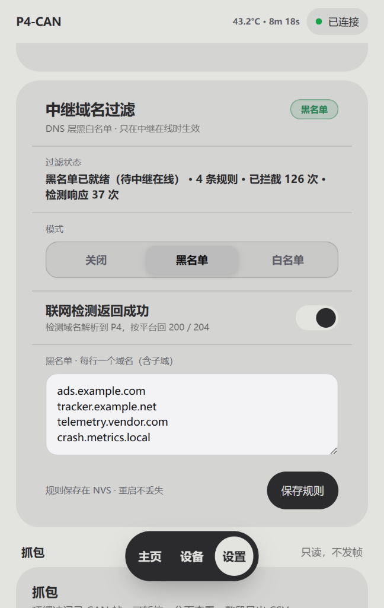
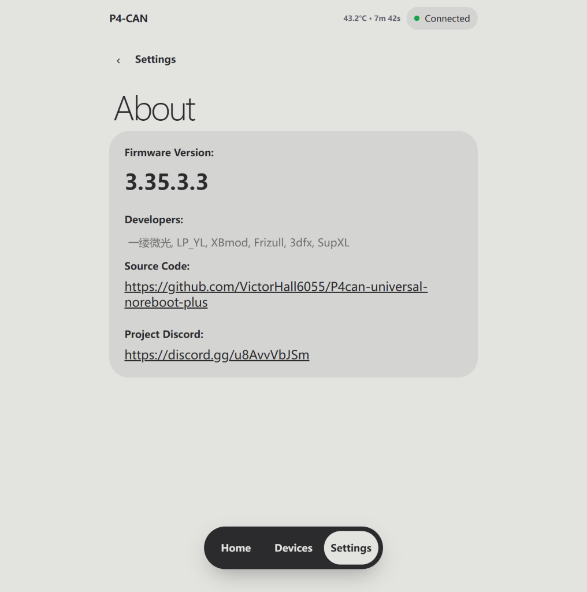
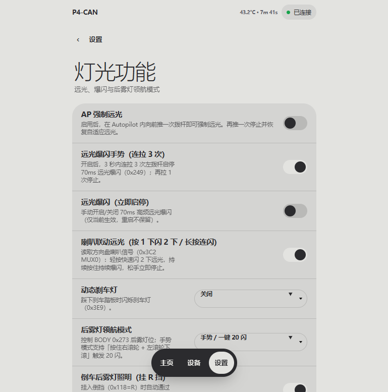
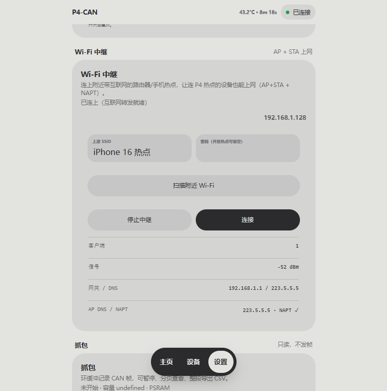
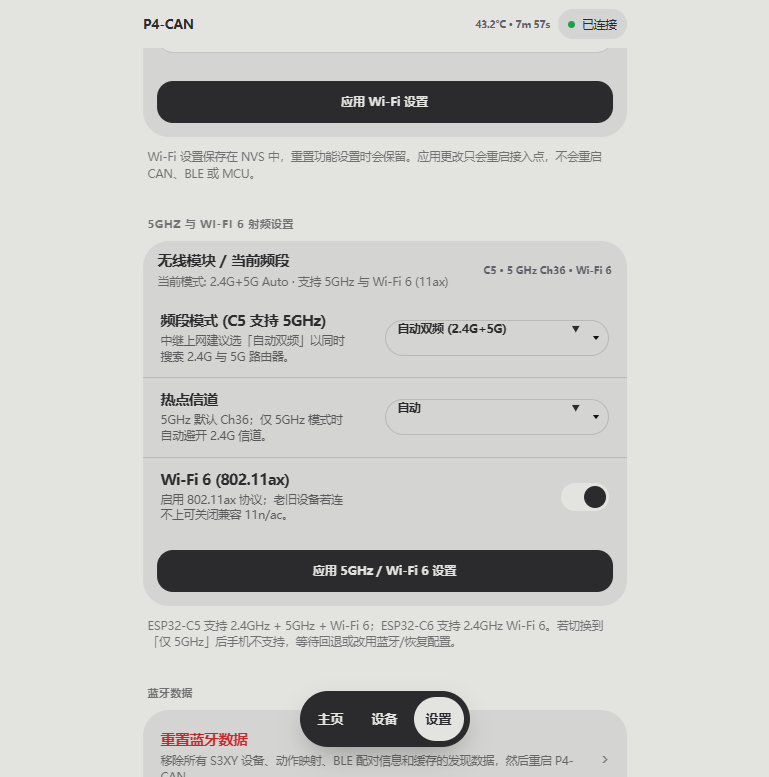
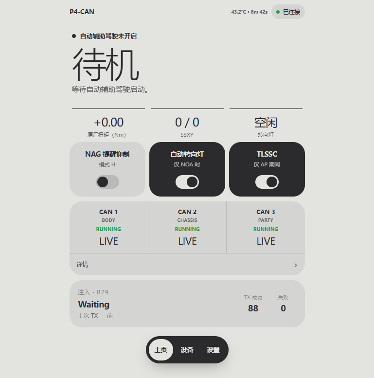

# P4can-universal-noreboot-plus（`3.35.3.3`）

> **语言 / Language**：**简体中文** | **[English (README.md)](README.md)**

本项目以 **[CARyanChan/P4can-universal-noreboot](https://github.com/CARyanChan/P4can-universal-noreboot)**（`v3.35.3-norestart2`）为核心基线与后台界面风格，融合 **[i520e3e4/p4can-unlock-more](https://github.com/i520e3e4/p4can-unlock-more)** 中已在实车 CAN 总线上验证可行的灯光、喇叭与领航模式功能，并完整适配 **ESP32-P4 + ESP32-C5（5GHz 双频 + Wi-Fi 6）** 与 **ESP32-P4 + ESP32-C6** 硬件。作者：**一缕微光**、LP_YL、XBmod、Frizull、3dfx、SupXL。

设计第一原则：**防重启模块（`tlssc_norestart.h` / `0x331`）在任何时候均保留最高发送与任务调度优先级（`P4_TLSSC_NR_PRIORITY_YIELD`）**，新增功能绝不抢占防重启窗口。

> **v3.35.3.3 更新内容**：
> - 修复 **倒车自动开启后雾灯闪烁不常亮** 问题（增加 250ms 倒车防抖及 `0x3E3` 状态闭环自适应切换/电平保持发送逻辑）。
> - 修复 **AP 强制远光无法保持** 问题（彻底清除跨核时间戳减法回绕，防止 `0x249` 自发回显破坏释放模板，解除 `0x3E9` 与繁忙分支互斥）。
> - 修复 **车辆封禁开关打开后每次休眠唤醒上车导致车机自动重启** 问题（NVS 精确保存 `0x331` 长度（Model 3/Y 为 6 字节）、解除慢速 CAN-A 就绪阻塞、增加 CAN-B 唤醒 50ms 高频瞬时重放）。
> - 新增 **UDP `42100` 热点中继局域网发现监听** 与 **新版三模式 Android 控制端 App（`v1.3.0`）**：支持 ① 原版 AP 直连（`192.168.4.1`）、② 手机热点中继免切 Wi-Fi 直连、③ 伪公网 IP（`100.100.1.1`）保存与直连。
> - 关于页开发者首位署名新增 **一缕微光**，固件版本升级至 `3.35.3.3`。

<p align="center">
  
  
</p>

---

## 本版重点新增与修复

### 1. 喇叭联动远光与完整灯光 / 领航套件（`lighting/`）
直接读取车身 CAN 总线 `0x3C2` MUX0 bit2（`VCLEFT_hornSwitchPressed` 方向盘物理喇叭开关），彻底避免哨兵模式提示音或离车落锁鸣笛造成的误闪：
- **轻按喇叭**：立即触发 **2 下远光快闪**（70 ms 半周期）。
- **长按喇叭**：持续高频爆闪，**松手立即停止**并补发释放帧（含 600 ms 超时自动保护）。
- **拨杆 / 无拨杆兼容**：有拨杆车型发送 `0x249` 拨杆拉动帧，无拨杆车型自动降级使用 `0x3E9`；且内置 `P4_TLSSC_NR_PRIORITY_YIELD` 检查，出现 `0x331` 补发时立即让位防重启。
- **同页完整灯光功能**：支持 **AP 强制远光**、**左拨杆连拉 3 次爆闪手势**、**立即爆闪开关**、**动态刹车灯（关闭 / 轻踩 / 重刹）**、**后雾灯领航模式（20 闪 / 1Hz 脉冲 / 常亮，`0x273`）** 以及 **倒车挂 R 挡自动点亮后雾灯（`0x118` → `0x273`）**，开关均支持 NVS 掉电记忆。

> 说明：原项目中仅能通过 BLE 蓝牙或尚未确认 CAN 报文的功能（例如氛围灯、座椅/空调调节）本着稳妥与总线安全原则未在 CAN 总线上强行伪造帧。

<p align="center">
  
</p>

### 2. Wi-Fi 中继上网模式修复（`AP + STA + NAPT + DNS`）
支持扫描并连接附近 2.4G / 5G 路由器或手机热点，同时保留模块自身的 `P4-CAN` 热点，让连着模块的手机或电脑直接访问互联网：
- **彻底解决“显示连上热点但电脑无法上网”的问题**：修复 `p4_uplink.h` 向 `esp_netif_dhcps_option(..., ESP_NETIF_DOMAIN_NAME_SERVER, ...)` 传入 IPv4 地址字节而非 `dhcps_offer_t`（`OFFER_DNS`）导致的 DHCP 不下发 DNS 缺陷；同步写入 `esp_netif_set_dns_info(MAIN/BACKUP)`、AP 启动默认 DNS（`223.5.5.5`），并在连上网后执行 `WiFi.STA.setDefault()` + `WiFi.AP.enableNAPT(true)`。
- **网段冲突检测与状态可见**：若手机热点恰好也使用了 `192.168.4.x` 网段（与 P4 默认 AP `192.168.4.1` 冲突），页面会给出明确提示；卡片底部实时显示 **AP DNS / NAPT** 状态（如 `223.5.5.5 · NAPT ✓`）。

<p align="center">
  
</p>

### 3. ESP32-P4 + C5 无 Wi-Fi 修复、双频 Wi-Fi 6 与模块访问地址（`192.168.4.1` / `100.100.1.1`）
- **C5 芯片通讯协议修复（`tools/patch_c5_hosted.py`）**：修补 Arduino ESP32 `3.3.12` 中 `libespressif__esp_hosted.a(transport_drv.c.obj)` 的 `process_priv_communication` 从机型号校验（将仅允许 `13 / esp32c6` 补丁为兼容 `23 / esp32c5`），解决部分 ESP32-P4 + C5 板子刷机后 Wi-Fi 无法启动的问题。
- **C5 双频与 Wi-Fi 6 独立设置（无线连接面板）**：仅在 C5 固件中开放 **频段模式**（`自动双频 2.4G+5G` / `仅 5GHz` / `仅 2.4GHz`）、**热点信道**（`自动`、2.4G Ch 1–11、5G Ch 36–165）以及 **Wi-Fi 6 (`802.11ax`)** 开关，并持久化至 NVS（老旧设备连不上时可随时关闭 Wi-Fi 6 回退 11n/ac）。C6 固件自动隐藏 5GHz 选项。
- **模块访问地址可选**：支持默认 **`192.168.4.1`** 与伪公网地址 **`100.100.1.1`** 切换并保存至 NVS，方便无法访问 `192.168.x.x` 私有网段的终端打开后台。

<p align="center">
  
</p>

### 4. 主页右上角温升 / 运行时长 & C5/C6 动态 CAN GPIO 编辑
- **全局右上角实时状态（`#topSysMeta`）**：读取 ESP32-P4 内部温度传感器（`temperatureRead()`，每 2 秒节流采样）与系统 `uptimeS`，在页面右上角在线状态左侧实时展示芯片温度与已运行时长（如 `43.2°C · 6m 42s`）。
- **修复后台 CAN 引脚无法编辑的问题**：C5 固件释放了 `GPIO 6`（C6 用于通信占用），此前前端按 C6 固定列表严格校验导致 C5 打开引脚页即报错并禁用全部 6 个输入框；现已改为动态校验后端下发的 `allowedPins`，并在初次选车界面增加 **「CAN 引脚接线不同？点击配置 CAN GPIO」** 入口，方便不同硬件接线的板子在启用前直接修改 TX/RX 引脚。

<p align="center">
  
</p>

### 5. 全新多模式 Android 控制端 App（`android-app/`，`v1.3.0`）
安装包直接下载：**[P4can-App-v1.3.0-multi-mode.apk](android-app/P4can-App-v1.3.0-multi-mode.apk)**（同时随 **GitHub Releases** 附带发布；由于更换签名，请先卸载旧版 `1.2.1` 后安装）：
- **模式 1 · 原始 AP 直连（`192.168.4.1`）**：保留原版自动/手动连接模块 Wi-Fi 逻辑。
- **模式 2 · 手机热点中继连接（免连 ESP32 热点）**：当手机已开启个人热点供 ESP32 中继联网时，无需再将手机 Wi-Fi 切去连模块；App 通过 **UDP `42100` 广播发现** + 热点网段并发探测自动定位 ESP32 并打开控制台，手机移动网络与热点全程在线（亦支持手动指定固定 IP）。
- **模式 3 · 伪公网 IP 直连（`100.100.1.1`）**：解除原版仅允许 `192.168.4.1` HTTP 保存与明文访问的限制，支持直接保存并连接 `100.100.1.1` 或其它合法内网 IPv4 地址。

---

## 核心基础功能保留
- **TLSSC 防重启（`0x331`）**：单次 NVS 缓存实车真实帧，上电 / 总线恢复 / 车机静默 >15s 重启窗口自动以 10Hz 补发最多 60s（600 帧），实车报文恢复即刻退避。
- **自动转向灯与 NAG 抑制（Mode H & TSL9）**、**R79 召唤时序修复**、**SmartShift 自动换挡（Beta）**、**电池预热（Beta）**、**连续 AP**、**服务模式**、**FSD 可视化**、**S3XY 蓝牙按键联动** 与 **PSRAM 独立抓包（支持 CSV 导出）**。

---

## 编译与烧录说明

> ⚠️ **仅限 32MB Flash 的 ESP32-P4 REV3.X 开发板**（分区方案 `app5M_fat24M_32MB`）。严禁刷入 16MB 板子，且务必按板载无线从机型号对应选择 **C5** 或 **C6** 固件！

### 一键编译 C5 + C6 中英文 4 个版本
环境要求：**Arduino CLI** + **esp32 core `3.3.12`**（`3.3.13` 更改了 TWAI HAL 符号会导致编译失败）+ Python 3：

```powershell
cd P4can-universal-noreboot
powershell -NoProfile -ExecutionPolicy Bypass -File .\Compile-P4-C5-C6.ps1
```

编译产物输出至 `Final-Build/`：
| 固件版本 | 从机芯片 / 无线规格 | 语言 | 网页 OTA 升级包 | 整片刷机 / 救砖包 |
| --- | --- | --- | --- | --- |
| C5 中文版 | ESP32-C5（双频 5G + Wi-Fi 6） | 简体中文 | `P4can-universal-noreboot.C5.zh-CN.OTA.REV3.X.bin` | `P4can-universal-noreboot.C5.zh-CN.FULLFLASH.REV3.X.merged.bin` |
| C5 英文版 | ESP32-C5（双频 5G + Wi-Fi 6） | English | `P4can-universal-noreboot.C5.en.OTA.REV3.X.bin` | `P4can-universal-noreboot.C5.en.FULLFLASH.REV3.X.merged.bin` |
| C6 中文版 | ESP32-C6（2.4G Wi-Fi 6） | 简体中文 | `P4can-universal-noreboot.C6.zh-CN.OTA.REV3.X.bin` | `P4can-universal-noreboot.C6.zh-CN.FULLFLASH.REV3.X.merged.bin` |
| C6 英文版 | ESP32-C6（2.4G Wi-Fi 6） | English | `P4can-universal-noreboot.C6.en.OTA.REV3.X.bin` | `P4can-universal-noreboot.C6.en.FULLFLASH.REV3.X.merged.bin` |

预编译固件与 SHA-256 校验见仓库 **Releases** 页面与 [Final-Build/manifest.json](Final-Build/manifest.json)。

---

## 致谢 / Credits

衷心感谢以下两个核心源项目的作者与贡献者，没有他们的扎实工作就没有本整合固件：
- **[CARyanChan/P4can-universal-noreboot](https://github.com/CARyanChan/P4can-universal-noreboot)** —— 提供防重启核心（`0x331`）、整体后台 UI 框架、Wi-Fi 中继与独立抓包架构及极高稳定性的主线基座。
- **[i520e3e4/p4can-unlock-more](https://github.com/i520e3e4/p4can-unlock-more)** —— 提供丰富的灯光联动、爆闪、后雾灯领航等扩展思路与逆向协议参考。
- 同时致敬上游源头项目：**[06066060606060/P4can-universal-unlock](https://github.com/06066060606060/P4can-universal-unlock)**、**[baicyber/P4can-No-Reboot](https://github.com/baicyber/P4can-No-Reboot)** 与 **[kl79613/P4Can-automatic-shifting](https://github.com/kl79613/P4Can-automatic-shifting)**。

---

## ⚠️ 风险提示与免责声明

> [!CAUTION]
> 1. **仅限封闭场地测试，切勿违法上路**：修改和向汽车 CAN 总线注入报文会直接影响车辆灯光、辅助驾驶提示及部分车身状态控制。**请勿在公共道路使用高频爆闪、强开远光或后雾灯领航等可能影响其他交通参与者视线与行车安全的功能**，务必严格遵守当地交通法规。
> 2. **硬件与刷机风险**：请仔细核对开发板 Flash 容量（仅支持 **32MB**）及无线从机型号（**C5 / C6 不可混刷**）；修改 CAN 引脚前**务必先断开整车/模块电源**，确认收发器 TX/RX 接线与电平匹配。
> 3. **开源免责**：本项目按 **GPL-3.0-or-later** 开源提供（详见 [LICENSE](LICENSE) 与 [THIRD_PARTY.md](THIRD_PARTY.md)），不提供任何明示或暗示的担保；与特斯拉公司（Tesla, Inc.）无任何关联。因刷写固件、改装接线或道路使用导致的车辆故障、质保失效、事故或法律责任均由使用者自行承担。

---

## 赞赏支持

如果这个开源项目帮到了你，欢迎请作者喝杯咖啡 ☕：

<p align="center">
  
</p>
